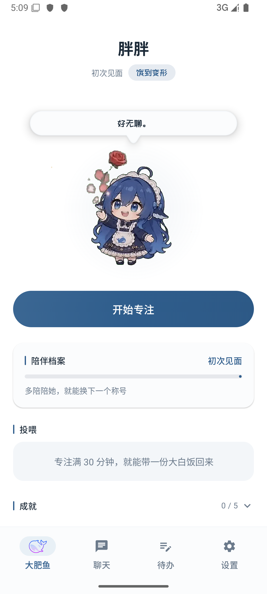
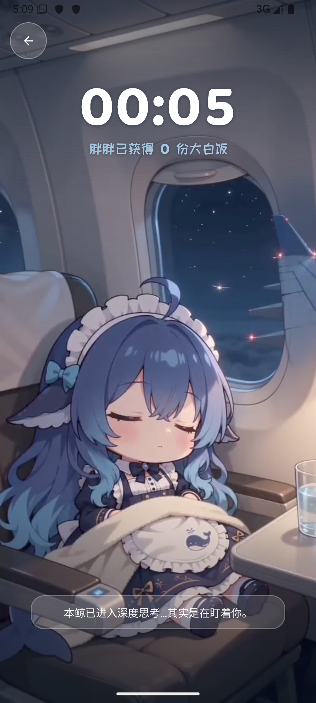

<h1 align="center">DeepFocus · 深焦</h1>
<p align="center">
  <strong>一条大肥鱼陪你专注，专注攒下的白饭喂给它</strong>
</p>
<p align="center">
  <a href="https://github.com/LiuYihey/DeepFocus/releases">下载 APK</a>
  ·
  <a href="docs/桌宠设计.md">桌宠设计</a>
  ·
  <a href="docs/专注页视频Prompt.md">专注视频 Prompt</a>
</p>

---

## 简介

想专注，却总在「再看一眼」里把一下午看没了？

**DeepFocus（深焦）** 把专注做成一件事：你坐得住，鱼就有饭吃。

- **专注计时** — 全屏旅行影像 + 计时器，进入即开始，不用配置一堆参数
- **大白饭奖励** — 每专注 30 分钟攒 1 份大白饭，单次最多 5 份
- **大肥鱼养成** — 投喂、好感度、成就；点一下白饭，它真的抱着碗吃
- **桌面陪伴** — 悬浮桌宠安静待在屏幕上，不自己乱跑，也不随机说话
- **AI 对话** — 自带人格卡，也可以接任意 OpenAI 兼容 API；它会记得你们聊过什么
- **游历本** — 专注满 15 分钟，它会出门旅行，带回一篇日记和一张插画
- **应用守护**（可选）— 专注时切去娱乐 App，会被温柔地拉回来

把「硬撑」变成「有人在等你回家吃饭」。

<p align="center">
  
  &nbsp;&nbsp;
  
</p>

---

## 功能亮点

| 功能 | 说明 |
|------|------|
| 专注计时 | 全屏 9:16 旅行影像循环播放，静音，不打扰 |
| 大白饭 | 每满 30 分钟 +1 份，单次专注最多 5 份 |
| 投喂 | 点击大白饭 → 播放「抱碗猛吃」专属动画，消耗 1 份并增加好感度 |
| 桌宠 | 1:1 跟手拖动、四档尺寸；不点击就停在原地，不随机冒台词 |
| 桌宠消息 | 只有 Agent 主动消息会冒气泡；TODO 催办走通知栏 |
| AI 对话 | 支持文字 / 图片；发图后可以先写配文，再一起发送 |
| 人格卡 | 内置 6 张卡，可按好感度解锁；也可自己写一张 |
| 游历本 | 专注满 15 分钟触发旅行，生成目的地、日记与插画 |
| 应用守护 | 无障碍 + 使用情况访问，检测到分心 App 时拉起反思页 |
| 数据本地 | 聊天、记忆、鱼的状态全部存在本机 SQLite |

---

## 下载安装

### 方式一：直接安装 APK（推荐）

从 [GitHub Releases](https://github.com/LiuYihey/DeepFocus/releases) 下载最新版 `DeepFocus-v1.0.0.apk`，在 Android 手机上安装即可。

> 首次安装需在系统设置中允许「安装未知来源应用」。

### 方式二：自行编译

#### 环境要求

- Android Studio Hedgehog (2023.1.1) 或更高版本
- JDK 17
- Android SDK（compileSdk 35）
- Windows / macOS / Linux

#### 构建步骤

```bash
# 1. 克隆仓库
git clone git@github.com:LiuYihey/DeepFocus.git
cd DeepFocus

# 2. 配置本地 SDK 路径（Android Studio 通常会自动生成）
# 创建 local.properties，内容示例：
# sdk.dir=C\:\\Users\\YourName\\AppData\\Local\\Android\\Sdk

# 3. （可选）配置 release 签名
cp gradle.properties.example gradle.properties
# 编辑 gradle.properties，填入 DEEPFOCUS_STORE_FILE / PASSWORD / KEY_ALIAS

# 4. 构建 Debug 版（无需签名，适合开发调试）
./gradlew assembleDebug
# Windows: gradlew.bat assembleDebug

# 5. 构建 Release 版（需配置签名密钥）
./gradlew assembleRelease
# 产物路径：app/build/outputs/apk/release/app-release.apk
```

---

## 首次使用权限

核心的专注与养成不需要任何危险权限；只有「应用守护」需要下面几项：

| 权限 | 用途 |
|------|------|
| 使用情况访问 | 判断当前前台是不是被约束的娱乐 App |
| 无障碍服务 | 检测应用切换，触发反思页 |
| 悬浮窗 | 显示桌宠与拦截页 |
| 通知（Android 13+） | TODO 催办、前台服务保活 |
| 电池优化白名单 | 避免系统杀掉后台守护服务 |

> 应用守护是可选的。只想计时和养鱼，不开也能正常用。

---

## 技术栈

- **语言**：Kotlin
- **UI**：Jetpack Compose + Material 3
- **架构**：MVVM + Hilt 依赖注入
- **数据库**：Room（KSP）
- **视频**：Media3 ExoPlayer（专注页静音循环）
- **最低系统**：Android 8.0（API 26）
- **目标系统**：Android 15（API 35）

---

## 项目结构

```
DeepFocus/
├── app/                        # 主应用模块
│   ├── src/main/java/          # Kotlin 源码
│   ├── src/main/assets/        # 桌宠动画、表情包、专注视频、人格卡
│   └── src/main/res/           # 资源与 Manifest
├── artwork/                    # 素材源文件与生成脚本的输入
├── tools/                      # 素材处理脚本（Python）
├── docs/                       # 设计文档与截图
├── archive/                    # 归档：旧工具、旧素材、历史测试与截图
├── logo.png                    # 项目 Logo
├── build.gradle.kts            # 顶层构建配置
├── settings.gradle.kts         # 模块配置
├── gradle.properties.example   # 签名配置模板（不含密钥）
└── gradlew.bat                 # Windows 构建脚本
```

---

## 隐私

- **所有数据都存在本机。** App 不上传聊天记录、记忆、专注数据。
- API Key 只保存在本地 SharedPreferences / 数据库，不经过任何中转服务器。
- 相册图片只在发送时压缩后随请求发给你自己配置的模型服务。
- 没有埋点、没有统计 SDK、没有广告。

---

## 素材版权

- **桌宠动态素材**：来自 [dsh-pet](https://github.com/PC2005-cloud/dsh-pet) 的
  `assets/webm/*.webm`（640×360 VP9-alpha 母版，转码成 animated WebP）
  - `assets/pet/anim/all/`（109 段 animated WebP，640×360）
  - **素材禁止商用**，二创在公开渠道须署名
- **主形象**：以用户提供的设定图 `大肥鱼.jpg` 为基准**原创生成**，可商用
  - 立绘 `assets/fish/bigfatfish.png`、无文字大立绘 `assets/stickers/st_{情绪}_big.webp`（11 张）
  - 视频 `assets/videos/focus/`（专注页背景，9:16 竖版，当前为「夜间航班」）
- 表情包（`assets/stickers/`，共 58 张 = 47 张带文字梗 + 11 张无文字大立绘）
  中的 47 张带文字梗来自 [fisharchive.cc](https://fisharchive.cc)「蓝色大肥鱼档案馆」，
  **二创同人素材，CC BY-NC-SA 4.0，禁商用**
- 内置人格卡正文（`assets/personas/builtin_cards.json`，6 张）来自 dsh 生态的
  高 star 开源仓库，MIT 许可，署名见 `artwork/persona_sources/MANIFEST.md`
- 未打包任何 Sketchfab / MakerWorld 的 NC 授权 3D 模型（避免授权风险）

> 素材生成流水线与踩坑记录见 [docs/视频资产清单.md](docs/视频资产清单.md)。

## 致谢

- [FocusCat](https://github.com/LiuYihey/FocusCat) —— 本项目的地基，双引擎拦截与专注逻辑来自它
- [dsh-pet](https://github.com/PC2005-cloud/dsh-pet) —— 桌宠动作库与交互思路的蓝本
- [DeepSeek Harness](https://github.com/deepseek-ai/deepseek-harness) —— dsh 插件生态本体
- [dsh-speak-up](https://github.com/Yuuyoko-uu/dsh-speak-up) —— 主动开口的命中线公式
- [dsh-whale-musume](https://github.com/Sutera-Diffusus/dsh-whale-musume) —— 双档冷却与本地台词库的思路
- [dsh-fish-memory](https://blog.csdn.net/m0_73859037/article/details/169645300) —— 记忆半衰期与注入上限的参数
- [Michitop 桌宠用户研究](https://edwardyi.me/pdf/Michitop_Paper.pdf) —— 桌宠交互的反面清单

## License

代码以 MIT 协议开源。素材部分不适用 MIT，请遵守各自来源的授权。

<p align="center">
  <sub>Made with 🐟 by LiuYihey</sub>
</p>
